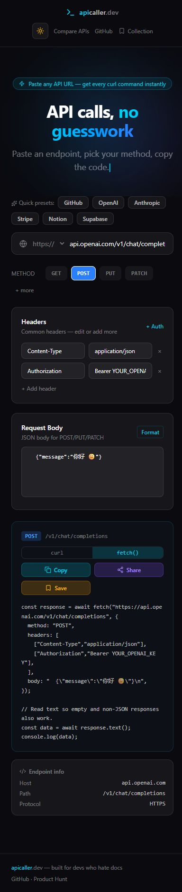
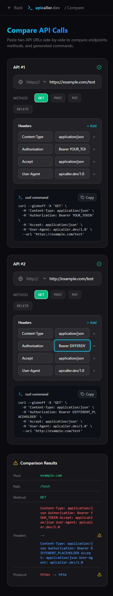

# Fresh-user verification — 2026-10-27

Repository: `thakoreh/apicaller` (ownership and push permissions verified). Baseline: `b9e037df09a8301e0ac75c7686c0765c315833a6`, package `0.1.0`, private. No version tags or GitHub Releases were listed. The public artifact is the [GitHub Pages builder](https://thakoreh.github.io/apicaller/), not an npm package.

QA ran in a new clone under `C:\Users\Hiren\Documents\Codex\2026-10-27\task-3\apicaller` on Windows, Node `20.19.3`, npm `10.8.2`, Git Bash, and Chromium browsers. Other existing checkouts were untouched. Root `AGENTS.md`, README, package/install scripts, workflow, and the installed Next.js static-export documentation were read before changes. No `.agents` directory or additional repository instructions were present.

## Reproduced defects and fixes

| Reproduction | Baseline result | Fix and regression evidence |
| --- | --- | --- |
| URL `https://example.com/O'Reilly`; fetch output | Invalid JS string, reproduced on the public site | JSON string literals; generated code executes only against a fake fetch |
| JSON body that is malformed or contains executable expressions; raw body with backticks, `${...}`, backslashes or surrounding whitespace | Syntax failure, expression execution, or altered body | All body text is serialized literally and preserved; regression executes generated code with a fake response |
| curl URL/header containing apostrophe; body starting `@file`; URL containing brackets | Broken shell arguments, file-body semantics, or curl globbing | Quote all arguments; `--data-raw`, `--url`, `--globoff`; fake Bash curl asserts exact arguments without network access |
| HEAD; OPTIONS with a body; empty/non-JSON responses | HEAD transfer behavior wrong, OPTIONS body omitted, unconditional `response.json()` fails | curl `--head`; only GET/HEAD suppress bodies; response text works for empty/text/JSON payloads |
| Two identical header names; CRLF/invalid names/non-byte values | fetch silently overwrites one value; curl/fetch accept different input contracts | Fetch tuple rows preserve duplicates; common validator shows an error and disables generation/copy/share for invalid headers |
| `ftp://example.com`, embedded URL credentials, uppercase HTTPS | Non-HTTP input could be reinterpreted as a host; credentials silently dropped | Explicit HTTP(S) validation, case-insensitive scheme handling, visible invalid-input guidance |
| Select HTTP, including before entering a hostname | Selector did nothing; incomplete HTTP selection reverted visually | Protocol controls update the URL and retain the typed scheme in both pages |
| Share body `你好 🙂`; reload shared page | `btoa` InvalidCharacterError, reproduced on public site | UTF-8 Base64 plus old Latin-1 compatibility; real copy/share/reload passed |
| Malformed fragment such as `{"url":42,"headers":{}}`; malformed stored data | Unchecked values could crash rendering | Validate shape, method, format and headers before hydration; bad link produces an alert, bad history/collection entries are ignored |
| Clipboard rejection; unavailable browser storage | Unhandled promise/storage errors | Visible clipboard error/manual copy guidance; storage failures keep in-memory editing available |
| Load saved request with no headers/empty body after editing another request | Previous body/default headers leaked into restored request | Restore exact empty state; browser test with deterministic prompt response passed |
| Compare equal endpoints with different protocol or headers | Incorrect “identical” result | Compare generated request configuration and display headers/protocol differences |
| `npm run lint` | Failed on hydration effects and JSX quotes | Hydrate external state in a queued callback; fix JSX and unused values; clean lint |
| `npm run build`, then `npm start` | Next rejects `next start` with `output: export` | Dependency-free loopback static preview; base path, compare/assets/HEAD, CLI help/errors and containment tests |
| `npm audit --audit-level=high` | 11 advisories: 1 critical, 8 high, 1 moderate, 1 low | Next/ESLint config `16.4.3` and compatible lockfile refresh; final audit reports zero |

The original request-generator regression command was `node --test tests/requests.test.cjs`; it failed before fixes on URL validation, JS/body serialization, response handling and shell argument preservation. The complete suite now has 12 passing tests. The tests invoke only synthetic functions, a fake curl, and a local static fixture server; generated provider requests are never executed.

## Exact checks

Initial locked dependencies were inspected using `npm ci --ignore-scripts --no-audit --no-fund` with a new clone-local npm cache. After inspecting install hooks, a second clean checkout was created from the fix commit with `git clone --no-hardlinks . .qa-consumer`. This checkout had no node_modules/build output/configuration/cache. Its PowerShell environment was isolated for the normal README install:

```powershell
$qaHome = Join-Path (Get-Location) '.qa-home'
New-Item -ItemType Directory -Force -Path $qaHome | Out-Null
$env:HOME = $qaHome
$env:USERPROFILE = $qaHome
$env:npm_config_userconfig = Join-Path $qaHome '.npmrc'
Set-Content -LiteralPath $env:npm_config_userconfig -Value ''
$env:npm_config_cache = Join-Path (Get-Location) '.qa-empty-cache'
$env:TEMP = Join-Path (Get-Location) '.qa-temp'
$env:TMP = $env:TEMP
New-Item -ItemType Directory -Force -Path $env:TEMP | Out-Null
$env:NEXT_TELEMETRY_DISABLED = '1'
npm ci
npm test
npm run lint
npm run build
npm audit --audit-level=high
npm start -- --port 3104
```

| Check | Result |
| --- | --- |
| Normal `npm ci` in clean consumer, isolated HOME/config/cache/TEMP | Passed; 360 packages, no vulnerabilities |
| `npm test` | Passed, 12 tests including generated JS/Bash execution and preview subprocess tests |
| `npm run lint` | Passed without warnings |
| `npm run build` | Passed, Next `16.4.3`; static `/` and `/compare` |
| `npm audit --audit-level=high` | Passed, zero vulnerabilities |
| `npm run dev -- --hostname 127.0.0.1 --port 3103` | Passed with workspace TEMP and cleared clone-local `.next/dev` cache; browser HTTP 200 |
| `npm start -- --port 3104`, clean-consumer `out/` | Passed; actual browser exercised both routes and assets |
| Public Pages artifact | Loaded; apostrophe generation, inactive protocol and Unicode sharing defects reproduced; still unpatched |
| Final artifact desktop/mobile 390×844 | Passed; document scroll width 384 at viewport width 390 on builder and compare |
| Copy, Unicode share/reload, invalid URL/header guards, Ctrl+K focus | Passed; copied text equals generated code; shortcut focuses API URL |
| Clipboard denied, save/load body and zero headers | Passed using temporary local page mocks; reloading removes mocks |
| Malformed share hash and synthetic corrupted storage | Passed, builder remains usable and shows invalid-share feedback |
| Native Chrome prompt automation | Coverage limit: prompt opened, browser automation timed out handling it; QA tab was closed; save-state path tested with deterministic prompt mock |
| Remote push and draft PR | Direct approval received; branch pushed and [PR #1](https://github.com/thakoreh/apicaller/pull/1) opened |
| Exact-head remote CI | See [PR checks](https://github.com/thakoreh/apicaller/pull/1/checks) for the current immutable head and terminal results |
| Physical mobile device, Firefox/Safari, screen reader | Not run |
| Live authenticated/provider API calls | Not run; no keys, spend, or private data used |

Initial restricted-sandbox Next dev/Git Bash subprocesses failed on sandbox process/temp permissions; reviewed elevated local runs and workspace TEMP succeeded. The nested clean-consumer build emitted a harmless Next warning that it ignored the parent clone's lockfile outside the consumer Git root; it used its own lockfile and passed. The added QA workflow runs normal install/test/lint/build on standalone Linux Node 20/22 and Windows Node 20 checkouts. Its first Node 22 run exposed a test-runner difference: `node --test tests` no longer accepts the directory as Node 20 did. The npm script now lists both test files explicitly, avoiding shell glob and runtime directory-discovery differences.

## Delivery and production limits

The branch contains code, regression tests, a read-only QA workflow, updated README and these screenshots. No merge, tag, package publication or deployment was performed. Although merging the audited fix was approved, site deployment remains excluded. The existing Pages workflow deploys on every push to `main`, so this specific merge is held until deployment is explicitly approved. The published site remains affected. Server-specific dependency advisories do not imply the same exposure in this static-only Pages deployment, but fresh local development/build tooling is updated.




